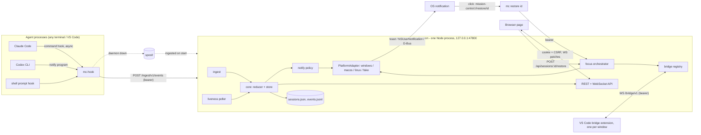
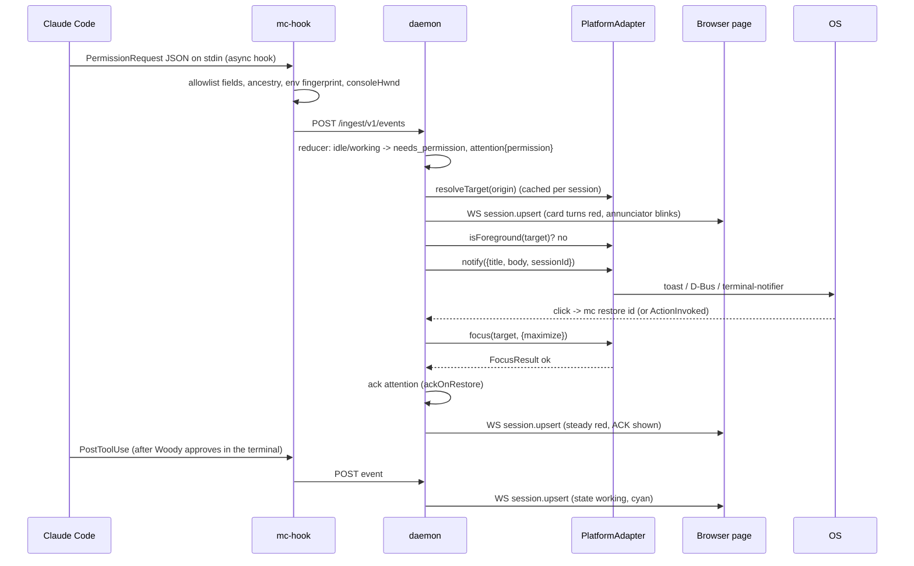

# Architecture

## 1. Components

| Component | Package | Responsibility |
|---|---|---|
| contracts | `packages/contracts` | JSON Schemas copied from `docs/contracts/`, generated TS types, Ajv validators, fixtures, schema lock test. No logic. |
| core | `packages/core` | Pure functions: the attention reducer, the session store, the notify policy, host classification, callsign allocation. No I/O, no timers except through an injected clock. |
| platform | `packages/platform` | `PlatformAdapter` interface, `FakePlatform`, and one implementation per OS. Process ancestry utilities shared with the hook. |
| daemon | `packages/daemon` | Fastify server: ingest, API, WebSocket, bridge endpoint, auth, persistence, liveness, focus orchestration, wiring core to platform. |
| hook | `packages/hook` | `mc-hook` CLI: reads an agent event, fingerprints its process and terminal, POSTs or spools. Must be fast and never fail. |
| cli | `packages/cli` | `mc` CLI: `start`, `stop`, `status`, `open`, `restore`, `doctor`, `install`/`uninstall` (claude-code, codex, shell, vscode, uri-handler, autostart). |
| ui | `packages/ui` | React page: flight director bar, console grid, cards, pairing, WebSocket client. Built to static files served by the daemon. |
| vscode-bridge | `packages/vscode-bridge` | VS Code extension (D-07). |
| e2e | `e2e/` | Playwright specs against the real daemon with `MC_PLATFORM=fake`. |

Dependency direction (enforced by an ESLint `no-restricted-imports` rule in T001):
`contracts` <- `core` <- `platform` <- `daemon`; `contracts` <- `hook` (and
`platform/process` only); `contracts` <- `ui`; `contracts` <- `vscode-bridge`;
`cli` may import `daemon`, `platform`, `contracts`. `ui` and `vscode-bridge` never
import Node-only packages.

## 2. Process model

- **Daemon:** one long-lived Node process per OS user, started by `mc start` (detached)
  or by the autostart entry (`mc install autostart`). Single-instance: on start it
  reads `<stateDir>/daemon.json`; if that PID is alive and `GET /healthz` answers with
  the same PID, it exits 0 printing `already running pid=<pid> port=<port>`.
- **mc-hook:** one short-lived process per agent event. Budget: read stdin, build the
  envelope, one HTTP POST with a 800 ms timeout, exit. Hard ceiling 1500 ms enforced by
  a self-kill timer. Exit code is always 0; stdout is always empty (Claude Code would
  otherwise parse it as hook output).
- **Platform helpers:** spawned by the daemon on demand with a 3 s timeout
  (`powershell.exe -NoProfile -NonInteractive`, `osascript`, `wmctrl`, `swaymsg`, ...).
  Windows Win32 calls run in-process through koffi. At most 4 helper processes at once
  (a semaphore in the daemon); focus requests for the same session are serialized.
- **VS Code bridge:** runs inside each VS Code window's extension host; reconnects with
  backoff 1 s, 2 s, 5 s, 10 s (max) when the daemon is down.
- **Notification click:** the OS launches `mc restore <id> --from-notification`
  through the registered `mission-control://` URI handler (Windows, Linux `.desktop`
  `x-scheme-handler`, macOS via terminal-notifier `-open`); on Linux, D-Bus
  `ActionInvoked` reaches the daemon directly.

## 3. Data flow: a permission prompt, end to end

## 4. Target resolution (how a session maps to a window)

Runs in the daemon on every ingested envelope whose `origin` differs from the cached
one, and lazily on RESTORE. Inputs: `origin` (`docs/contracts/ingest.md` 3) and the
bridge registry. Output: an internal `RestoreTarget` (never sent to clients) plus the
public `host` and `restore.capability` fields.

1. `classifyHost(origin)` in core (pure, rule table in `docs/contracts/ingest.md` 5)
   gives `host.kind` and `host.multiplexer`.
2. If `host.kind` is `vscode-terminal` or `vscode-extension`: look up the bridge whose
   terminals include a PID in `origin.ancestry` (terminal) or whose `extHostPid` is in
   the ancestry (extension). Target = `{kind: "vscode", bridgeWindowId, terminalId?,
   nativeWindow?}` where `nativeWindow` is the D-08 binding.
3. Otherwise `platform.resolveWindow(origin)` returns the native window (HWND, AX
   window of a PID, X11 window id, compositor window id) plus an inner selector
   (`{tty}` for Terminal.app/iTerm2, `{wtTabTitle}` for Windows Terminal,
   `{tmuxPane}`, `{kittyWindowId}`, `{weztermPane}`).
4. Capability: `full` when both window and inner selector are resolvable and the
   platform reports it can act on them; `window` when only the window; `none` with a
   `reason` code otherwise (`docs/contracts/session.schema.json` `restore.reason`).

## 5. State and persistence

- In memory: `Map<SessionId, SessionRecord>` where `SessionRecord = { session:
  Session (public), target: RestoreTarget | null, lastSeq: {pid, seq, sentAt} }`.
- Every mutation produces a new `Session` object and a monotonically increasing
  `stateSeq`; the WebSocket sends `session.upsert` with that `seq`. A client that
  detects a gap reloads `GET /api/state`.
- `sessions.json` is the public sessions plus targets, written atomically (write
  `sessions.json.tmp`, fsync, rename) debounced 500 ms and on shutdown.
- `events.jsonl` appends every accepted envelope after redaction, for debugging and
  replay (`mc replay <file>` is a later milestone; not in v1 tasks).

## 6. Liveness

Every 5 s the daemon checks each non-ended session with a known `agentPid`:
`platform.processAlive(pid, startTime)` (PID exists and its start time matches,
defeating PID reuse). Dead → reducer event `ProcessExited` → `ended` with
`endReason: process_exit`. Sessions with no PID and no event for
`sessions.lostAfterHours` → `lost`. Ended and lost sessions are removed after
`sessions.retainEndedHours`.

## 7. Security model

Threats, in order of how much they matter on a single-user workstation:

| # | Threat | Control |
|---|---|---|
| S1 | A web page in Woody's browser sends requests to `127.0.0.1:47800` (CSRF) to focus windows or read session titles. | State-changing routes require the session cookie (`SameSite=Strict`) **and** header `X-MC-CSRF` equal to the HMAC of the cookie under the daemon token (issued at pairing, re-readable by the same origin at `GET /api/csrf`, api.md 2). `Origin`, when present, must equal `http://127.0.0.1:<port>` or `http://localhost:<port>`. No CORS headers are ever sent; `OPTIONS` returns 405. Reads (`GET /api/state`) also require the cookie, so a cross-site page cannot read them (and gets no CORS anyway). |
| S2 | DNS rebinding: `evil.example` resolves to 127.0.0.1. | `Host` header must be exactly `127.0.0.1:<port>` or `localhost:<port>`; otherwise 421 before any routing. WebSocket upgrades check `Host` and `Origin` too. |
| S3 | Another local user on a shared machine. | Bind `127.0.0.1` only. Token file `<stateDir>/token` is created with mode 0600 (POSIX) or an ACL granting only the current user (Windows `icacls /inheritance:r /grant:r <user>:F`). Ingest, bridge and CLI routes need `Authorization: Bearer <token>`. |
| S4 | A malicious local process as the same user. | Out of scope: it can already read the token, drive the UI and focus windows itself. Noted, not defended. |
| S5 | Secrets leaking into session data (prompts, tool args). | D-12 allowlist and truncation in the hook; the daemon re-applies the same allowlist (defence in depth); `events.jsonl` stores only the redacted envelope. |
| S6 | `mission-control://` links on a web page focusing windows. | The handler accepts only `restore/<sessionId>` matching the id pattern, a session that exists, rate limit 2 per second; worst case a window comes forward. Browsers ask before opening external protocols. |
| S7 | The bridge endpoint being driven by a page. | `/bridge/v1` requires the bearer token and rejects any request carrying an `Origin` header that is not `vscode-file://vscode-app` or absent. |
| S8 | Window-handle injection: a client passing an arbitrary HWND to focus. | No API takes a window handle, PID or path. Every action takes a `sessionId`; targets are daemon-internal. |

Bearer vs cookie: `/api/*` accepts either a valid cookie + CSRF header, or a valid
bearer token on a request **without** an `Origin` header (the CLI). `/ingest/*` and
`/bridge/*` accept bearer only. `/healthz` is unauthenticated and returns only
`{ok, pid, version}`.

## 8. Failure behaviour

| Failure | Behaviour |
|---|---|
| Daemon down | Hooks spool (D-11); page shows "LOS: DAEMON" full-width banner and retries WS every 2 s. |
| Platform helper times out | `FocusResult {status: "error", code: "timeout"}`; card shows the result chip for 5 s. |
| Notification backend unavailable | Logged once per backend per run; page shows a "NOTIFY: NO-GO" light in the flight director bar with the reason; Web Notifications channel used if the page has permission. |
| Config invalid on reload | Keep previous config, log, page shows "CONFIG: HOLD" with the Ajv error path. |
| Unknown event name from an adapter | Recorded, counted in `stats`, no state change. |
| Event for an unknown session that is not a start event | Creates the card in `working` (Claude Code started before the daemon was installed). |
